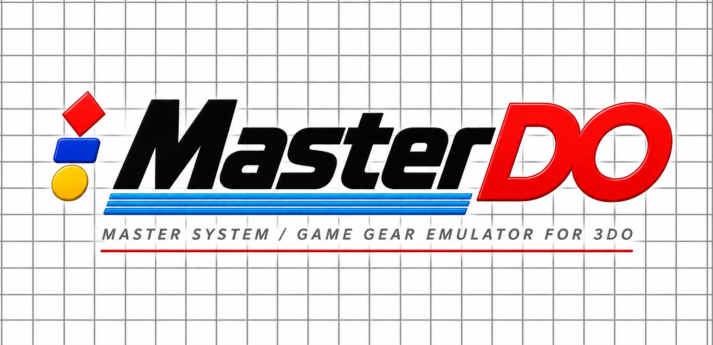

# MasterDO



**A Sega Master System and Game Gear emulator for the 3DO Interactive Multiplayer.**

Demo of the emulator on a PAL FZ-1: https://youtu.be/oiTg0YGS2Z8

## Table of contents

- [Intro](#intro)
- [Usage](#usage)
- [Build](#build)
- [Compatibility list](#compatibility-list)
- [Technical aspects](#technical-aspects)
- [What is left to do](#what-is-left-to-do)
- [Credits](#credits)

## Intro

MasterDO is a Sega Master System / Game Gear emulator for the 3DO, entirely
vibe-coded with [Claude](https://claude.ai) (Anthropic): the emulator's C and
ARM assembly sources, its analysis tools and its documentation were written by
Claude, with every build played and checked on emulators and on a real console.

The 3DO's ARM60 runs at 12.5 MHz with no cache, only about 3.5 times the clock
of the Master System's Z80. A classic interpreter cannot keep up at that ratio,
so MasterDO translates the Z80 code into ARM code on the fly (a dynamic
recompiler written in ARM assembly) and draws the picture with the 3DO's
hardware CEL engine. The goal is full speed with no frame skipping: 60 frames
per second, every frame shown on an NTSC console.

### Features

- Master System games ✅
- Game Gear games (160x144 LCD window, 4 096-colour palette, stereo sound) ✅
- Full speed on most games: 60 frames per second, no frame skipping on NTSC consoles ✅
- NTSC and PAL 3DO consoles, with games running at their real 60 Hz speed on PAL consoles ✅
- Two players on Master System games (second 3DO pad) ✅
- Battery-backed game saves, kept in the 3DO's NVRAM (one file per game) ✅
- Savestate: one quick save / quick load slot kept in the NVRAM, which survives a power-off ✅
- PSG sound (SN76489) played on the 3DO's DSP, with the Game Gear's stereo ✅
- Sega and Codemasters mappers ✅
- Cartridge images up to 4 MiB (images over 512 KiB are read from the disc bank by bank) ✅
- ROM menu browsing folders, with page and initial letter navigation ✅
- Pause screen, with a way back to the menu without resetting the console ✅

### Tested successfully on

- a PAL Panasonic FZ-1 3DO console, from a burned CD-R
- the Phoenix emulator
- the 4DO emulator

### Tests still to do

- [ ] an ODE
- [ ] an NTSC console

## Usage

The games are written to the disc when the ISO is built (see [Build](#build)).
Burn the ISO to a CD-R, or open it in a 3DO emulator: the console boots on the
ROM menu.

### Main menu

The menu lists the folders of the disc's `roms` directory, then the `.sms` and
`.gg` images of the current folder, sorted by name. At the root, the
`Master_System` and `Game_Gear` folders come first, then any other folder.
Underscores in file and folder names are shown as spaces. The first lines show
the display type (NTSC or PAL), the memory left, the current folder and the
cursor's position in it. At the root (three folders at most), each folder is
shown as a box, over a "ROM nomenclature" panel that explains the region and
translation codes that end the image names.

| 3DO button   | Action                                              |
|--------------|-----------------------------------------------------|
| Up / Down    | Previous / next entry (held: scrolls faster and faster) |
| Left / Right | Previous / next page (20 entries)                   |
| L / R        | Previous / next initial letter                      |
| A or P       | Open the folder, or start the game                  |
| B            | Back to the parent folder                           |
| X (Stop)     | Quit (at the root folder only)                      |

When a game is left, the menu comes back on the same folder and the same game.

### In-game controls

| 3DO button     | Pad 1                                        | Pad 2 (Master System only) |
|----------------|----------------------------------------------|----------------------------|
| D-pad          | D-pad                                        | D-pad                      |
| A              | Button 1                                     | Button 1                   |
| B              | Button 2                                     | Button 2                   |
| P (Play/Pause) | PAUSE (Master System) / START (Game Gear)    | PAUSE                      |
| L              | Save the state                               | -                          |
| R              | Load the state                               | -                          |
| X (Stop)       | Pause screen                                 | -                          |
| C              | Debug view (development build only, see [Build](#build)) | -              |

- **Second pad**: the second 3DO pad of the daisy chain is the Master System's
  second controller. It is read once the game reads the second controller
  port, and never in Game Gear mode (the Game Gear has a single pad).
- **Pause screen** (X): a black screen with the image's name and size and the
  display type. X or P resumes the game, C goes back to the main menu; the
  other buttons do nothing. The game's save is written to the NVRAM when the
  pause screen opens.
- **Savestate** (L / R): there is one savestate for the whole console, kept in
  the NVRAM across resets and power-offs. Saving replaces the previous state,
  whichever game it belonged to, and takes a few seconds (the state is
  compressed to fit the small NVRAM); loading takes about a second. A message
  over the picture tells the result: `STATE SAVED`, `STATE LOADED`,
  `NO STATE SAVED FOR THIS GAME` (the state belongs to another game, or there
  is none), `STATE: NVRAM FULL`.
- **Game saves**: nothing to do. The cartridge's battery RAM is read from the
  NVRAM when the game starts and written back shortly after the game finishes
  its own save, and when the game is paused or left. `SAVE: NVRAM FULL` is shown
  when the NVRAM has no room left. The save files are named after the image
  files and can be seen or deleted in the 3DO's storage manager.

## Build

MasterDO is built with [3do-devkit](https://github.com/trapexit/3do-devkit):
install it first by following its instructions,
[Download and install](https://github.com/trapexit/3do-devkit#download-and-install).

The Makefile finds the devkit in this order:

1. the `TDO_DEVKIT_PATH` variable, set by sourcing the devkit's `activate-env`;
2. a `.devkit-path` file at the root of this repository, holding the devkit's path;
3. the directory of the Makefile itself (MasterDO's files copied into the devkit).

### Steps

```sh
git clone https://github.com/stanton0arch/MasterDO.git
cd MasterDO
source /path/to/3do-devkit/activate-env   # or: echo /path/to/3do-devkit > .devkit-path

mkdir -p takeme/roms/Master_System takeme/roms/Game_Gear
# copy your Master System images (.sms) into takeme/roms/Master_System
# copy your Game Gear images (.gg) into takeme/roms/Game_Gear

make clean && make
```

The ISO is ready in `iso/masterdo.iso`.

### Naming the images

Everything under `takeme` goes to the disc, so the names must suit both the
3DO file system and the Makefile:

- `.sms` or `.gg` extension: the extension chooses the Master System or the
  Game Gear mode;
- **31 characters at most**, extension included (the build fails beyond);
- **no special characters**: no spaces (use `_`, shown as a space in the menu),
  no `:` or `;`, no name ending with `)`. Letters, digits, `_`, `-` and `.` are
  safe;
- subfolders are allowed, at any depth, and other folders can sit next to
  `Master_System` and `Game_Gear`;
- images larger than 512 KiB must be whole 16 KiB banks (no copier header),
  4 MiB at most.

No game image is provided with MasterDO: use dumps of your own cartridges.

### Notes

- `make clean` deletes the `iso` directory: copy the ISO elsewhere before
  building again if you want to keep it.
- **Never run `make distclean`**: it ends with `git clean -xfd`, which deletes
  every untracked and ignored file of the repository, your ROMs and any devkit
  files copied into it included.
- `src/options.h` chooses the build. `MASTERDO_DEBUG 1` (the default in the
  repository) is the development build: C pauses the game on a debug view (the
  picture drawn by the CPU next to the CEL engine's, the presentation mode) and
  writes the run's figures to the debug log. `MASTERDO_DEBUG 0` is the release
  build, without any of it. The tagged releases (`v0.1`, `v0.2`) are release
  builds: `git checkout v0.2` then `make clean && make` rebuilds one.

## Compatibility list

- [Master System](compatibility_master_system.md)
- [Game Gear](compatibility_game_gear.md)

The fluidity of each title is estimated in the ARM60 cycle model of the
emulator (`tools/arm60model/compat.py`), not measured by playing the games
on a console: one image per title, a few minutes of blind play each.

## Technical aspects

### The two machines

|          | Master System / Game Gear                  | 3DO                                              |
|----------|--------------------------------------------|--------------------------------------------------|
| CPU      | Zilog Z80 at 3.58 MHz                      | ARM60 at 12.5 MHz, no cache                      |
| Video    | Sega VDP: tiles, 64 sprites, line interrupts | CEL engine: hardware drawing of bitmaps (cels) into screens |
| Sound    | SN76489 PSG: three square waves and a noise channel | DSP, programmed through the audio folio  |
| Memory   | 8 KiB of RAM, 16 KiB of video RAM, cartridges of 32 KiB to 1 MiB | 2 MiB of DRAM and 1 MiB of VRAM for everything |

### Z80 dynamic recompiler

- Z80 code is translated into ARM code one block at a time and the
  translation is kept for the next runs. Code that runs rarely stays in an
  interpreter written in ARM assembly that works on the same registers; a
  block is translated once it has been entered a few times, and the spare time
  at the end of each frame translates the code the game is about to reach.
  When a game starts, the code reachable in the cartridge is translated ahead.
- The Z80 registers live in ARM registers. Flags are only computed when a later
  instruction can read them, and a flag only tested by the next conditional
  jump stays in the ARM flags.
- T-states are counted per segment (the instructions between two conditional
  jumps), with one check per segment, down to the next machine event
  (interrupt, line counter, end of frame) rather than to the end of every
  scanline: the generated code only stops a few times per frame.
- Blocks are chained by direct branches; returns and computed jumps go through
  a table of the 65 536 Z80 addresses.
- Busy-wait loops (polling a RAM flag or the V counter) are recognised: their
  time goes by idle up to the next event, as with `HALT`.
- Code in banked ROM checks its bank on entry. Code in RAM checks its bytes on
  entry and is translated again when the game rewrites it; the operands of
  jumps and loads in RAM code are taken as constants until they are seen
  rewritten.
- Port loops (`OTIR`, `INIR`, `OUTI` chains...) and pairs of VDP control port
  writes are handled in one call; the line interrupt is delivered together with
  the line counter event.
- The translated code lives in a buffer of 32 KiB zones sized from the memory
  left. When it is full, the zone run least lately is emptied, ahead of time
  in spare time when possible; when the buffer turns over quickly, rarely
  entered code is left to the interpreter.
- The whole translator (decoder, analysis passes, emitter, block management)
  is written in ARM assembly. The Z80 core is checked with ZEXDOC.

### Picture with the CEL engine

Drawing the picture line by line in software would take about 15 ms per frame
on the ARM60, nearly the whole frame. MasterDO hands the drawing to the CEL
engine instead:

- Each name table in use is kept as an 8 bpp bitmap in the cel format. A cell
  is redrawn into it only when its name table entry changes or its tile is
  written, and only when the picture shows it.
- The visible picture is a few rectangular pieces of that bitmap, one cel each
  (the scroll wraps around). Scroll, palette and name table changes during the
  active display (raster effects driven by line interrupts) split the picture
  into bands, each band its own pieces.
- Sprites are one cel each, with the VDP's sprite evaluation deciding which
  lines the hardware shows (8 per line limit); zoomed sprites are scaled by the
  CEL engine.
- Priority tiles have a second bitmap, drawn after the sprites, or only the
  parts of it under the sprites.
- A picture identical to the previous one is shown again instead of drawn.
- Three screens: one on display, one queued, one being drawn. A presenter
  thread shows one screen per vertical blank, so the emulation works a frame
  ahead and a slow frame is absorbed by the screen still queued.
- In Game Gear mode, the 160x144 LCD window is centred in a black frame, with
  12-bit colours.

### Sound

Once per frame, the PSG registers are sent to five DSP instruments through the
audio folio: three square wave oscillators for the tone channels, a noise
source and a narrow pulse oscillator for the periodic noise. Only the values
that change are sent. The Game Gear's stereo register sets the gains of a
mixer.

### Memory and large cartridges

The 3DO's 3 MiB hold the system, the program, three screens, the cartridge
and the translated code. Images up to 512 KiB are loaded whole into VRAM,
which the ARM reads like DRAM, leaving the DRAM to the code buffer.

Larger images (up to 4 MiB) are read from the disc bank by bank: 40 buffers
of 16 KiB (32 in VRAM, 8 in DRAM) hold the banks, the first 40 are read when
the game loads (about 2 seconds), and a bank the game selects while absent is
read from the disc at once (about 56 ms on the double-speed drive) in the place
of a bank not used lately. The cartridge RAM is only allocated the first time
the game enables it.

### 60 Hz on PAL consoles

Every game runs on an emulated NTSC machine: 262 lines and 60 frames per
second. Nothing in a Master System cartridge tells a European release from an
American one, and most emulators run Master System games at 60 Hz by default;
the Game Gear is a 60 Hz machine anyway.

- **NTSC 3DO**: one emulated frame per vertical blank, every frame shown.
- **PAL 3DO**: the display refreshes at 50 Hz. One emulated frame per vertical
  blank would run every game, music included, 17 % slower than intended.
  MasterDO paces the emulation on the 3DO's timer instead: 60 frames per second,
  one every 16 683 us (the main task sleeps on the timer device between
  frames, and a late frame is caught up within a period), while the presenter
  thread shows one picture per 50 Hz vertical blank. The picture of a frame
  that finishes while the presentation queue is full is not drawn: one in six.
  Games and music keep the exact NTSC speed; the price is a slight, regular
  unevenness on scrolls, which is hard to notice in play. Without the timer,
  the emulator falls back to one frame per vertical blank.
- The screens are 320x240 bitmaps on both kinds of consoles: the PAL system's
  default 288-line bitmaps would take memory the code buffer needs.

### Saves

- **Game saves**: the cartridge's battery RAM is kept in a file of the NVRAM
  named after the image file, packed (runs of a byte compressed: a mostly empty
  RAM takes a few hundred bytes). The NVRAM is only 32 KiB, shared with every
  3DO game's saves, so the file is written only when the RAM changed, and no
  other file is ever written or removed. Since many games also use that RAM as
  work memory, the emulator watches it about once a second, block by block,
  and writes it in the spare time of a frame once a block has stopped changing
  after a write: a save the game has finished.
- **Savestate**: the machine as it stands between two frames (Z80, RAM, VDP,
  video and colour RAMs, mapper, cartridge RAM, PSG, Game Gear ports), packed
  with the cartridge image as the dictionary (typically 5 to 11 KB), in the
  file `masterdo.state` of the NVRAM. A state only loads into the image it was
  saved from.

### How it was developed

There are no automated tests on the console. Instead, an ARM60 cycle model
(`tools/arm60model`) runs the very code of the ISO on a PC, counts the cycles
of every instruction with the ARM60 datasheet's timings (weights fitted on
Phoenix, whose figures it predicts within a few percent) and replays the pad
inputs recorded on the console or in Phoenix (the development build prints
them as a pad script). Every change is measured on a panel of about thirty
recorded plays of Master System and Game Gear games before an ISO is built:
machine state hashes frame by frame, every picture compared with a reference
picture drawn by the CPU, and no regression allowed on any game.
`tools/ggref` is an independent timing reference built on another Z80 core.

### Source layout (`src/`)

| Files | Role |
|-------|------|
| `z80jit*.c`, `z80jit*.s`, `z80jit_int.h` | Z80 to ARM translator: decoder, analysis, emitter, block management, glue |
| `z80int_a.s` | Z80 interpreter for cold code |
| `smsmem*` | Memory map, Sega and Codemasters mappers, bank cache for large images |
| `vdp.c`, `vdp_a.s` | VDP: registers, memories, interrupts, counters, sprite evaluation |
| `sms.c`, `sms_io.s` | Machine: ports, pads, PSG writes, Game Gear registers |
| `render.c`, `render_a.s` | Picture with the CEL engine |
| `psg.c` | PSG on the DSP |
| `save.c`, `state.c`, `stpack.c` | Game saves, savestate and its packing |
| `game.c`, `main.c` | Frame loop, ROM menu, pause screen |
| `platform.c`, `clock.c`, `rom.c` | Display, presenter thread, clock, pads, image loading |
| `options.h` | Development or release build |

## What is left to do

- FM sound (the YM2413 FM unit used by Japanese Master System games): no stock
  DSP instrument fits it, a custom DSP instrument is needed.
- Digitised voices played through the PSG's volume registers: the registers are
  sent once per frame, so writes made faster than that are lost.
- An optional PAL machine (313 lines, 50 Hz) for the European releases that
  depend on it.
- Games that raise a line interrupt on every line run below 60 fps (Road
  Rash's races, about 47 fps).
- Short hitches when a game first reaches a lot of new code (level, race and
  fight starts), the time of its translation.
- The compatibility list.
- Tests with an ODE and on an NTSC console.
- Not supported: the SG-1000 / SC-3000 video modes (only the Master System's
  mode 4), the Light Phaser, Paddle, Sports Pad and 3-D Glasses, the Game
  Gear's link cable.

## Credits

- [3do-devkit](https://github.com/trapexit/3do-devkit) by trapexit, the
  toolchain and SDK that build the ISO.
- [SMS Power!](https://www.smspower.org/) for its documentation: Sega's official
  Master System and Game Gear manuals, Charles MacDonald's hardware notes and
  the SN76489 notes.
- SMSAdvance, a source of ideas for the implementation, and SMS Plus, whose Z80
  core serves as the independent reference of `tools/ggref`.
- The Phoenix and 4DO emulators, on which every build was played.

MasterDO is not affiliated with Sega or with The 3DO Company. Master System,
Game Gear and 3DO are trademarks of their respective owners.
